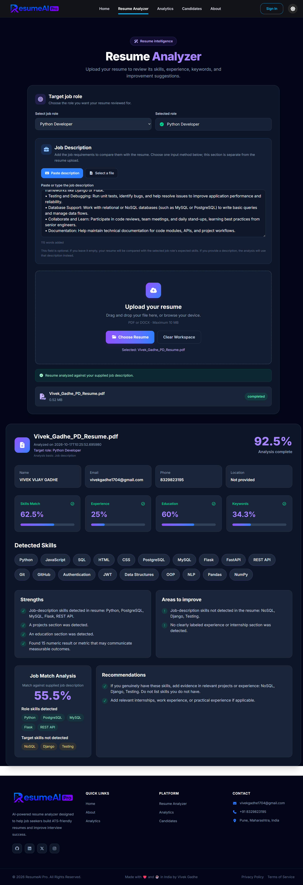
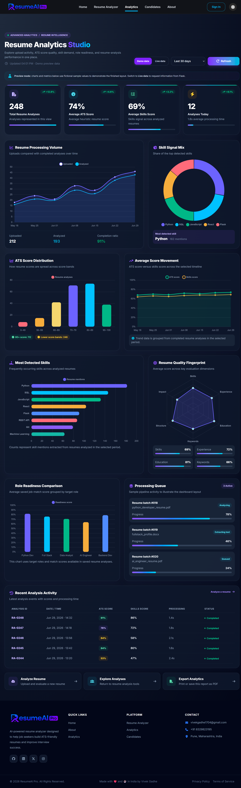
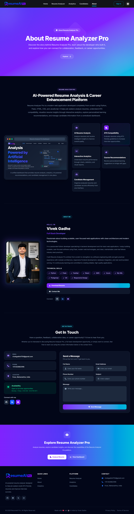
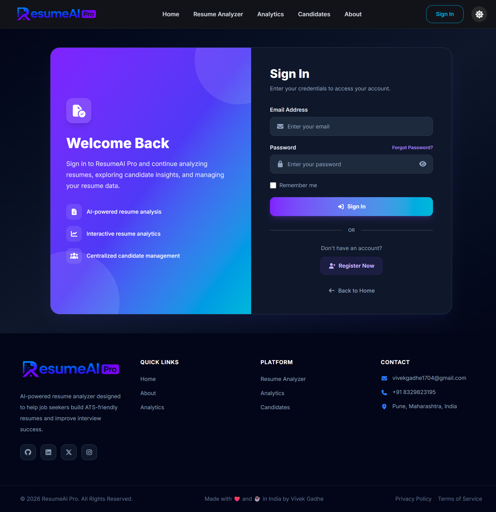
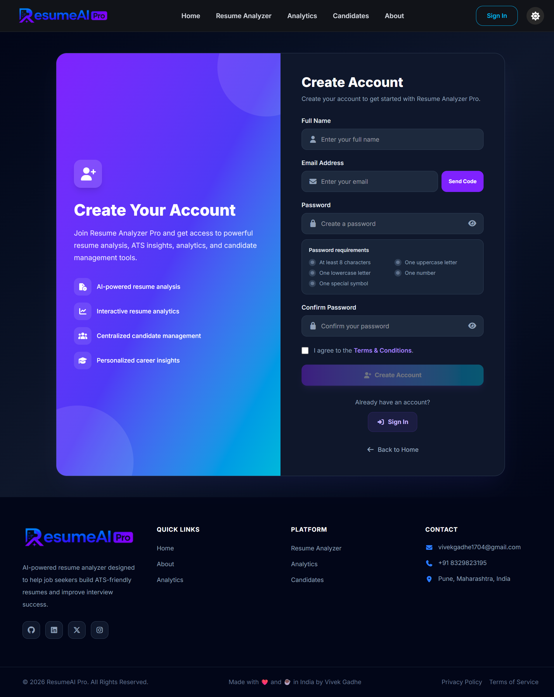
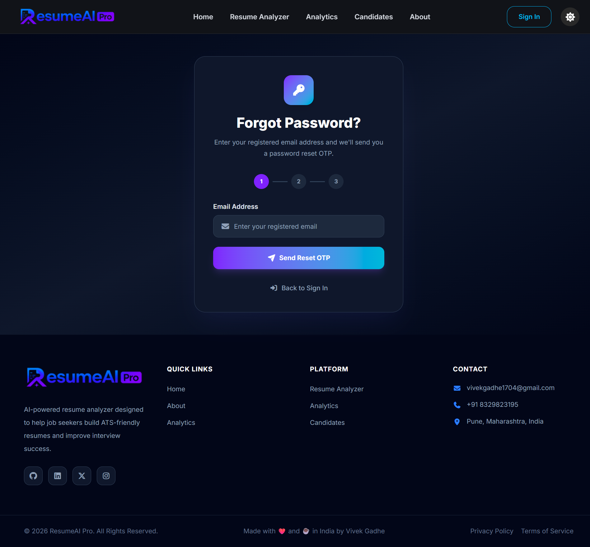
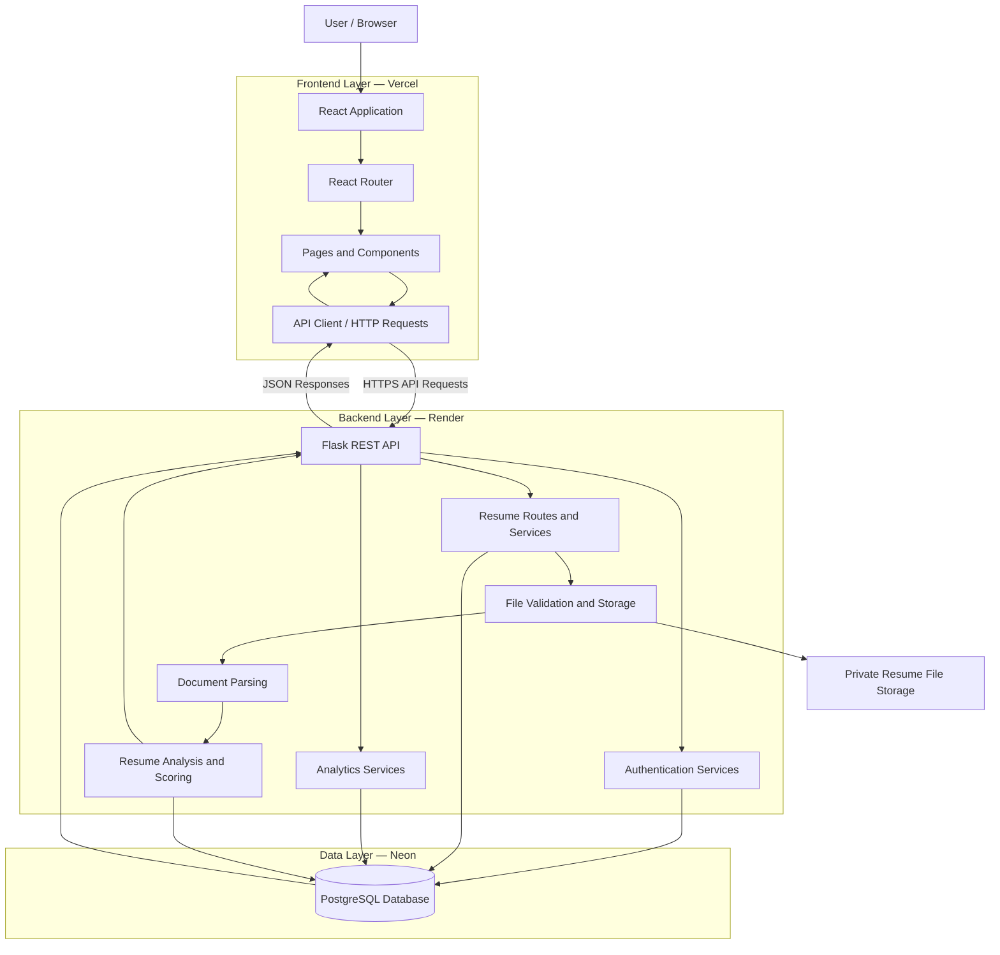
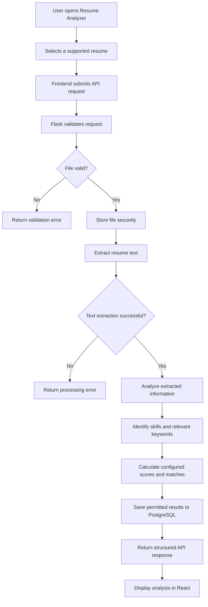
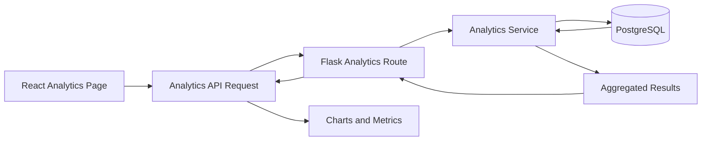
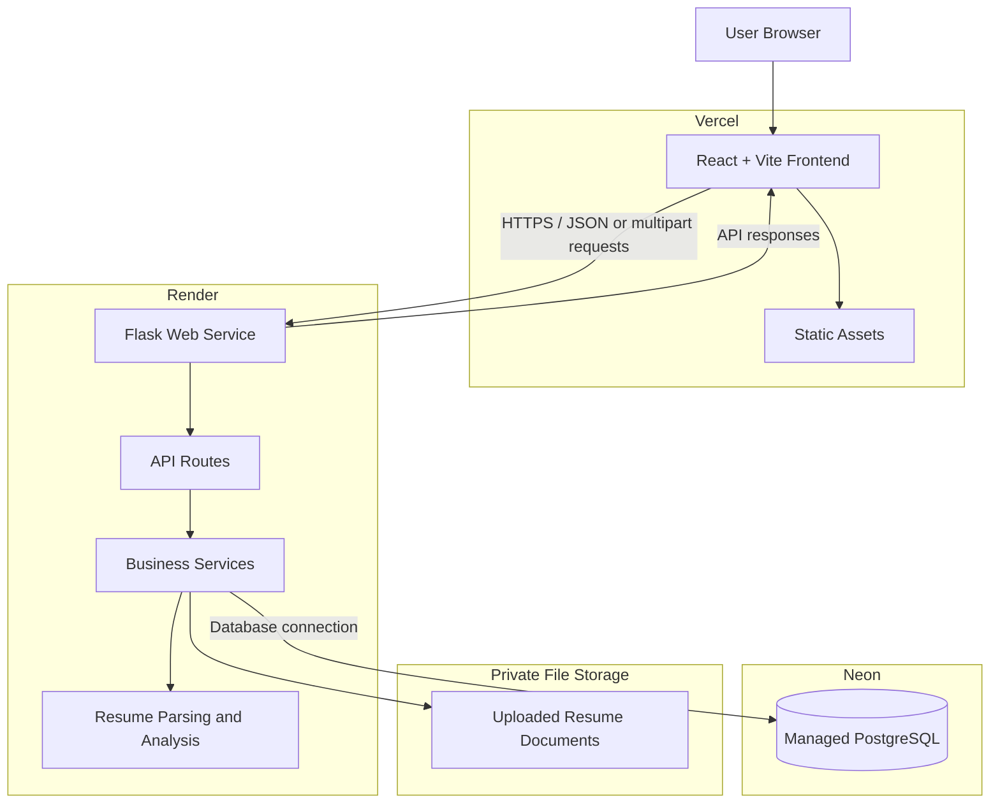

<div align="center">
  

  # 🤖 ResumeAI Pro

  ### AI-Powered Resume Analysis & Candidate Insights

  **Analyze resumes. Identify skills. Evaluate job-role compatibility. Explore actionable insights.**

  ResumeAI Pro is a full-stack web application designed to help users analyze resumes, review ATS-style scores, identify relevant skills, and explore candidate information through a modern dashboard.

  <br>

  
  
  
  
  
  

  <br>

  **Deployment Architecture**

  [Vercel](https://vercel.com/) · [Render](https://render.com/) · [Neon](https://neon.tech/)

</div>

---

## 📑 Table of Contents

- [Overview](#-overview)
- [Problem Statement](#-problem-statement)
- [Solution](#-solution)
- [Key Features](#-key-features)
- [Technology Stack](#-technology-stack)
- [System Architecture](#-system-architecture)
- [Project Structure](#-project-structure)
- [Getting Started](#-getting-started)
- [Environment Variables](#-environment-variables)
- [Database Migrations](#-database-migrations)
- [Deployment Guide](#-deployment-guide)
- [Security and Privacy](#-security-and-privacy)
- [Future Improvements](#-future-improvements)
- [Contributing](#-contributing)
- [Developer](#-developer)
- [License](#-license)

---

## 📖 Overview

ResumeAI Pro is a full-stack resume analysis platform built to simplify resume evaluation and provide structured insights into candidate information.

The application combines a modern React interface with a Python Flask backend and a PostgreSQL database.

It aims to help users understand resume quality, review extracted skills, explore job-role compatibility, and access candidate analytics through an intuitive interface.

### 🎯 Project Goals

- Simplify resume analysis and evaluation.
- Present ATS-style scoring and resume insights.
- Identify relevant and missing skills where supported by the analysis.
- Organize candidate information and analysis results.
- Provide a modern, responsive dashboard.
- Build a maintainable application with a separately deployable frontend and backend.

> **Disclaimer:** ATS-style scores and recommendations are indicators generated by the application. They do not guarantee that a resume will pass an employer's ATS or result in an interview.

---

## 🎯 Problem Statement

Job seekers often find it difficult to determine whether their resumes communicate their qualifications effectively or align with a specific job description.

Recruiters and hiring teams may also need to review large volumes of resumes and organize candidate information efficiently.

ResumeAI Pro aims to address these challenges by organizing resume information and presenting analysis results in a structured, accessible interface.

## 💡 Solution

ResumeAI Pro provides a web-based workflow for uploading resumes, processing their contents, reviewing analysis results, and exploring candidate information.

The platform combines:

- Resume processing and analysis.
- ATS-style score presentation.
- Technical skill identification.
- Job-role compatibility insights.
- Candidate management.
- Analytics and visual reporting.
- A modern React-based user interface.

---

## ✨ Key Features

### 📄 1. Resume Analysis

Analyze uploaded resumes and review the information extracted by the application.

- Resume upload and file processing.
- Resume text extraction for supported formats.
- ATS-style score presentation.
- Technical skill identification.
- Resume analysis results.
- Suggestions for improving resume content.

*Available results depend on the implemented analysis logic and supported file formats.*

### 🎯 2. Skill and Job-Role Matching

Review how a resume aligns with selected job requirements.

- Identify relevant skills.
- Display matched and missing skills where supported.
- Review job-role compatibility indicators.
- Explore suggestions for improving alignment with a target role.

### 👥 3. Candidate Management

Organize and review candidate information through a dedicated interface.

- Candidate listing.
- Candidate information and analysis details.
- Resume history where available.
- Candidate search and filtering where implemented.
- Resume preview or download where configured.

### 📊 4. Analytics Dashboard

Explore resume-related information through dashboard and analytics pages.

- Resume and candidate metrics.
- Analysis score visualizations.
- Skill-related insights.
- Resume activity and reporting where supported.
- Summary views for reviewing analysis results.

### 📈 5. Resume Insights

Present analysis results in a structured format to help users understand potential areas for improvement.

- Resume evaluation summaries.
- Skill matching information.
- Missing-skill indicators where supported.
- Recommendations generated by the application.
- Candidate analysis reports where implemented.

### 🔐 6. Authentication Interfaces

The frontend includes pages for:

- User sign-in.
- User registration.
- Password recovery.

Authentication security and backend authorization depend on the actual implementation and configuration.

### 📱 7. Modern User Interface

- React component-based architecture.
- Vite development and build tooling.
- Tailwind CSS and project-specific styling.
- React Router navigation.
- Reusable navigation and footer components.
- Responsive page layouts.

---
---

## 🖥️ Application Pages and Navigation

ResumeAI Pro is organized into dedicated pages to provide a structured experience for resume analysis, candidate management, analytics, and account access.

The frontend is built using React, with page components organized inside `frontend/src/pages/` and navigation managed through React Router.

### 🌐 Application Navigation

Once the application is deployed, users will be able to navigate between the pages through the application's navigation menu.

**Live Application:** Replace `YOUR_VERCEL_URL` with your actual Vercel deployment URL.

| Page | Route | Description |
|---|---|---|
| 🏠 Home | `/` | Introduction to ResumeAI Pro and its core capabilities |
| 📄 Resume Analyzer | `/resume-analyzer` | Interface for uploading resumes and reviewing analysis results |
| 📊 Analytics | `/analytics` | Dashboard for visualizing resume and candidate metrics |
| 👥 Candidates | `/candidates` | Interface for viewing and managing candidate information |
| ℹ️ About | `/about` | Information about the project and its purpose |
| 🔐 Sign In | `/signin` | Interface for existing users to sign in |
| 📝 Register | `/register` | Interface for new users to register |
| 🔑 Forgot Password | `/forgot-password` | Interface for initiating password recovery |

> **Important:** These are suggested public-facing paths based on the page names and previously discussed routing. Confirm the actual route definitions in `frontend/src/App.jsx` before publishing the links.

### 🏠 1. Home Page

**Component:** `frontend/src/pages/Home.jsx`

**Route:** `/`

The Home page introduces ResumeAI Pro and communicates the purpose of the platform.

It serves as the main entry point for visitors and provides an overview of the application's resume analysis capabilities.

**Purpose:**
- Introduce the application.
- Explain the core value of resume analysis.
- Present the main features of the platform.
- Direct users toward the relevant application sections.

**Navigation link:**

[Open Home Page](https://YOUR_VERCEL_URL/)


### 📄 2. Resume Analyzer

**Component:** `frontend/src/pages/ResumeAnalyzer.jsx`

**Route:** `/resume-analyzer`

The Resume Analyzer page provides the primary interface for resume processing and analysis.

Users can upload supported resumes and review the analysis generated by the backend.

Depending on the analysis implementation, the page may display:

- Resume analysis results.
- ATS-style compatibility scores.
- Extracted technical skills.
- Matched and missing skills.
- Job-role compatibility indicators.
- Resume improvement recommendations.

The frontend communicates with the Flask backend to submit resumes and retrieve analysis results.

**Navigation link:**

[Open Resume Analyzer](https://YOUR_VERCEL_URL/resume-analyzer)



### 📊 3. Analytics Dashboard

**Component:** `frontend/src/pages/Analytics.jsx`

**Route:** `/analytics`

The Analytics page provides a visual overview of resume-related information and analysis results.

Its purpose is to help users explore patterns and summaries through charts, metrics, and other visual elements.

Depending on the available backend data, analytics may include:

- Resume analysis statistics.
- ATS-style score distributions.
- Skill-related summaries.
- Candidate metrics.
- Resume processing trends.
- Other analysis-related indicators.

The analytics displayed depend on the data returned by the backend API.

**Navigation link:**

[Open Analytics Dashboard](https://YOUR_VERCEL_URL/analytics)



### 👥 4. Candidate Management

**Component:** `frontend/src/pages/Candidates.jsx`

**Route:** `/candidates`

The Candidates page provides an interface for reviewing candidate records and associated resume analysis information.

Depending on the implemented functionality, users may be able to:

- View candidate information.
- Review resume analysis details.
- Explore extracted skills.
- Review matched and missing skills.
- Read resume improvement recommendations.
- Preview or download resumes when authorized.

Candidate information and original resume files should be accessible only to appropriately authorized users.

**Navigation link:**

[Open Candidate Management](https://YOUR_VERCEL_URL/candidates)


### ℹ️ 5. About Page

**Component:** `frontend/src/pages/About.jsx`

**Route:** `/about`

The About page explains the purpose of ResumeAI Pro and provides information about the project.

It can include:

- Project objectives.
- The problem the application addresses.
- Technologies used.
- Developer information.
- Relevant professional and project links.

**Navigation link:**

[Open About Page](https://YOUR_VERCEL_URL/about)



### 🔐 6. Sign In Page

**Component:** `frontend/src/pages/SignIn.jsx`

**Route:** `/signin`

The Sign In page provides the interface for existing users to access their accounts.

When authentication is configured, the frontend should submit credentials to the Flask backend and handle the response securely.

Authentication must be enforced by the backend. Hiding frontend pages alone does not protect private API endpoints.

**Navigation link:**

[Open Sign In](https://YOUR_VERCEL_URL/signin)




### 📝 7. Registration Page

**Component:** `frontend/src/pages/Register.jsx`

**Route:** `/register`

The Register page provides an interface for new users to create accounts.

The backend should validate registration data, securely hash passwords, and enforce appropriate account-creation rules.

Email verification may be included if implemented and configured in the backend.

**Navigation link:**

[Open Registration](https://YOUR_VERCEL_URL/register)




### 🔑 8. Forgot Password Page

**Component:** `frontend/src/pages/ForgotPassword.jsx`

**Route:** `/forgot-password`

The Forgot Password page provides an interface for users who need to recover access to their accounts.

When implemented, the recovery workflow should use secure, time-limited verification and reset mechanisms handled by the backend.

The page should avoid revealing whether an email address belongs to a registered user.

**Navigation link:**

[Open Password Recovery](https://YOUR_VERCEL_URL/forgot-password)



### 🧭 Shared Navigation Components

#### Navbar

**Component:** `frontend/src/components/navbar.jsx`

The Navbar provides shared navigation between application pages.

Depending on the existing implementation, it may contain:

- Application logo.
- Navigation links.
- Active-page indicators.
- Responsive mobile navigation.
- Theme controls.

#### Footer

**Component:** `frontend/src/components/Footer.jsx`

The Footer provides a consistent bottom section across application pages.

It can contain project information, navigation links, and relevant external resources.

### 🔗 Frontend Routing

**File:** `frontend/src/App.jsx`

The App component connects page components to application routes through React Router.

A route configuration may resemble the following:

```jsx
<Routes>
  <Route path="/" element={<Home />} />
  <Route path="/resume-analyzer" element={<ResumeAnalyzer />} />
  <Route path="/analytics" element={<Analytics />} />
  <Route path="/candidates" element={<Candidates />} />
  <Route path="/about" element={<About />} />
  <Route path="/signin" element={<SignIn />} />
  <Route path="/register" element={<Register />} />
  <Route path="/forgot-password" element={<ForgotPassword />} />
</Routes>
```

This is an illustrative example. Use the routes actually defined in your application.

---

## 🏗️ System Architecture

ResumeAI Pro follows a layered application architecture that separates the user interface, API handling, business logic, document processing, and persistent data storage.

The planned deployment architecture uses:

- **React + Vite on Vercel** for the frontend.
- **Python + Flask on Render** for the backend API.
- **PostgreSQL on Neon** for persistent application data.

These services are intended to work together while remaining independently deployable.

### 1. High-Level Architecture



**Deployment note:** The diagram represents the intended architecture. Actual connections and capabilities depend on the implemented code and deployment configuration.

### 2. Frontend Layer — React and Vite

**Location:** `frontend/`

**Planned hosting:** Vercel

The frontend is responsible for rendering the application interface, collecting user input, presenting analysis results, and communicating with the backend API.

#### Main responsibilities

- Render the Home page and other application pages.
- Manage navigation through React Router.
- Display resume analysis results.
- Present candidate details and analytics.
- Send HTTP requests to the backend.
- Display loading, success, and error states.
- Provide responsive layouts for different screen sizes.

#### Main frontend modules

| File or Directory | Responsibility |
|---|---|
| `frontend/src/main.jsx` | Initializes the React application |
| `frontend/src/App.jsx` | Configures application components and routes |
| `frontend/src/pages/` | Contains page-level components |
| `frontend/src/components/` | Contains reusable interface components |
| `frontend/src/config/` | Contains shared configuration and homepage data |
| `frontend/src/index.css` | Contains global styles and Tailwind CSS imports |
| `frontend/package.json` | Defines frontend dependencies and scripts |
| `frontend/vite.config.js` | Configures Vite |

#### Frontend-to-backend communication

The frontend sends requests to the Flask API over HTTPS after deployment.

For example, an API request may retrieve candidate records or submit a resume for analysis.

The frontend should obtain the API base URL from its environment configuration rather than relying on a hardcoded production URL.

A frontend environment variable may look like:

```env
VITE_API_BASE_URL=https://your-api.onrender.com
```

Replace the example URL with the actual deployed backend address.

Variables prefixed with `VITE_` are exposed to client-side code. They must never contain database credentials or other private secrets.

### 3. API Layer — Flask

**Location:** `backend/`

**Planned hosting:** Render

The Flask backend provides the server-side API consumed by the React frontend.

It is responsible for validating requests, invoking application services, interacting with the database, and returning appropriate responses.

#### Main responsibilities

- Handle API requests.
- Validate incoming data.
- Process supported resume uploads.
- Invoke resume parsing and analysis services.
- Manage database operations.
- Return analysis results and application data.
- Handle expected errors.
- Enforce authentication and authorization where required.

#### Backend entry point

**File:** `backend/app.py`

The application entry point initializes the Flask application and connects the configured routes and extensions.

**File:** `backend/extensions.py`

This module centralizes shared Flask extensions and integrations used by the application.

**File:** `backend/config/settings.py`

This module contains application configuration. Sensitive values should be loaded from environment variables rather than hardcoded into source files.

### 4. Routing Layer

**Location:** `backend/routes/`

The routing layer exposes API endpoints to the frontend.

| Module | Responsibility |
|---|---|
| `auth.py` | Authentication-related API endpoints |
| `resume_routes.py` | Resume upload, analysis, and retrieval endpoints |
| `analytics_routes.py` | Analytics-related endpoints |

Routes should validate incoming requests and delegate complex business operations to the appropriate service modules.

Keeping route handlers separate from business logic improves maintainability and makes the application easier to test.

### 5. Service Layer

**Location:** `backend/services/`

The service layer contains business logic used by API routes.

| Service | Responsibility |
|---|---|
| `analysis_service.py` | Resume analysis and scoring logic |
| `auth_service.py` | Authentication business logic |
| `email_service.py` | Email delivery, when configured |
| `file_service.py` | File validation and storage operations |
| `otp_service.py` | OTP-related operations |
| `parser_service.py` | Resume text extraction and parsing |
| `password_service.py` | Password-related operations |
| `resume_service.py` | Resume processing and related business logic |

This separation helps keep route handlers focused on HTTP requests and responses while reusable processing logic remains in dedicated modules.

### 6. Resume Processing Workflow

The resume analysis workflow begins when a user submits a supported document through the frontend.

The backend validates the request, processes the document, performs the configured analysis, and returns results to the frontend.



The specific analysis steps and stored fields depend on the implemented services and database models.

#### Processing stages

**Stage 1: Upload**

The frontend sends the selected document to the backend through the configured resume API.

**Stage 2: Validation**

The backend checks whether the file meets the application's supported format and size requirements.

**Stage 3: File handling**

The file service handles storage and file-related operations.

**Stage 4: Text extraction**

The parser service extracts text from supported documents.

**Stage 5: Analysis**

The analysis service evaluates the extracted information using the application's configured analysis logic.

**Stage 6: Persistence**

The backend saves the appropriate resume metadata and analysis results to PostgreSQL when required by the workflow.

**Stage 7: Response**

The API returns structured results that the frontend can render.

**Stage 8: Visualization**

The Resume Analyzer, Candidates, and Analytics pages display the information relevant to each interface.

> An ATS-style score is an application-generated indicator. Its accuracy depends on the implemented scoring method and available input data.

### 7. Database Layer — PostgreSQL

**Database:** PostgreSQL

**Planned hosting:** Neon

PostgreSQL provides persistent storage for application data.

The backend accesses the database through its configured database integration and ORM.

#### Main database models

| Model | Purpose |
|---|---|
| `user.py` | Represents user account data |
| `resume.py` | Represents resume records and metadata |
| `resume_analysis.py` | Represents resume analysis results |
| `email_otp.py` | Represents OTP-related records |

These descriptions reflect the model filenames in the shared project structure. The exact fields and relationships are defined by the model implementations.

#### Database responsibilities

- Store user information where implemented.
- Store resume metadata.
- Store analysis results.
- Maintain relationships between relevant records.
- Support queries used by candidate and analytics interfaces.
- Preserve schema changes through migration scripts.

#### Database migrations

The `backend/migrations/` directory contains the database migration history.

Flask-Migrate and Alembic can be used to apply schema changes when configured.

Typical command:

```bash
flask db upgrade
```

Run this from the configured backend environment after verifying the target database.

### 8. File Storage Architecture

Resume documents require special handling because they may contain sensitive personal information.

The existing project structure includes:

```text
backend/
└── uploads/
    └── resumes/
```

This directory represents local file storage used during development.

Local filesystem storage should not be assumed to provide durable storage in a hosted environment. Files may be lost when instances are replaced or redeployed unless persistent storage is configured.

For deployment, consider private object storage with appropriate access controls.

A production file-storage design should:

- Keep uploaded documents private.
- Validate file types and sizes.
- Generate unique storage names.
- Avoid exposing filesystem paths to users.
- Restrict downloads to authorized requests.
- Apply appropriate retention and deletion policies.
- Avoid committing uploaded resumes to GitHub.

The PostgreSQL database can store resume metadata and a storage reference while the document itself is stored in an appropriate private storage service.

### 9. Authentication and Authorization Architecture

Authentication-related interfaces and backend services are present in the shared project structure.

A secure deployment should distinguish between:

**Authentication:** Establishing the identity of a user.

**Authorization:** Determining which resources and actions that user is allowed to access.

For example, a candidate endpoint should not return private resume information to a user who lacks permission to access it.

Backend authorization should be enforced for protected API routes, including resume retrieval and download endpoints.

Frontend navigation restrictions are not a substitute for backend authorization.

### 10. Analytics Data Flow

The Analytics page depends on data provided by the backend.

A typical workflow is:



Depending on the implemented API, analytics may include resume counts, analysis scores, skill summaries, or other metrics derived from stored data.

The dashboard should display only metrics that are actually calculated by the backend.

### 11. Deployment Architecture

The planned production deployment separates the frontend, backend, and database.



#### Vercel: Frontend Hosting

Vercel serves the React frontend and its production assets.

The frontend uses the configured API base URL to communicate with the backend.

#### Render: Backend Hosting

Render runs the Flask API.

The backend processes requests, performs resume-related operations, and communicates with the database and file-storage service.

#### Neon: Database Hosting

Neon provides the managed PostgreSQL database.

The database connection string must be stored as a protected backend environment variable.

#### Private File Storage

Resume files should be stored in a suitable private storage system when durable storage is required.

The file-storage provider can be selected separately from the frontend, backend, and database hosting providers.

### 12. Configuration and Communication

The deployed services need compatible configuration.

| Configuration | Responsibility |
|---|---|
| Frontend API URL | Identifies the deployed backend API |
| Backend database URL | Connects Flask to PostgreSQL |
| Flask secret configuration | Supports the configured application security mechanisms |
| CORS origins | Controls which browser origins may call the API |
| Email configuration | Supports email features if enabled |
| File-storage configuration | Connects the backend to the configured storage provider |

The frontend should use the public API URL, while private configuration remains on the backend.

### 13. Architecture Benefits

This architecture provides several practical benefits:

- **Separation of concerns:** UI, API, business logic, and data storage have distinct responsibilities.
- **Independent deployment:** Frontend and backend can be deployed separately from one repository.
- **Maintainability:** Routes, services, models, and page components are organized into dedicated modules.
- **Scalability:** Each hosted service can be configured independently as requirements change.
- **Security:** Database credentials remain outside frontend code.
- **Testability:** Backend services and frontend components can be tested independently.
- **Extensibility:** Additional analysis services and application pages can be introduced without redesigning the entire project.

---

## 🛠️ Technology Stack

| Category | Technology | Purpose |
|---|---|---|
| Frontend | React | Component-based user interface |
| Frontend tooling | Vite | Development server and production build |
| Styling | Tailwind CSS and CSS | Application styling |
| Routing | React Router | Frontend navigation |
| Backend | Python | Server-side application logic |
| API framework | Flask | Backend API and request handling |
| ORM | SQLAlchemy | Database interaction |
| Database | PostgreSQL | Persistent application data |
| Database migrations | Flask-Migrate / Alembic | Database schema changes, as configured |
| Document processing | Python parsing services | Resume file processing and text extraction |
| Frontend hosting | Vercel | Planned frontend deployment |
| Backend hosting | Render | Planned API deployment |
| Database hosting | Neon | Planned managed PostgreSQL database |
| Version control | Git and GitHub | Source control and collaboration |

The exact dependency versions and installed libraries are defined by the project's dependency files.

---

## 🏗️ System Architecture

ResumeAI Pro is designed to separate the frontend, backend, and database.

```text
                      ┌──────────────────────┐
                      │      USER / BROWSER  │
                      └──────────┬───────────┘
                                 │
                                 ▼
                      ┌──────────────────────┐
                      │   React + Vite       │
                      │   Frontend           │
                      │   Vercel (Planned)   │
                      └──────────┬───────────┘
                                 │
                           HTTPS API Calls
                                 │
                                 ▼
                      ┌──────────────────────┐
                      │    Flask REST API    │
                      │    Render (Planned)  │
                      └──────────┬───────────┘
                                 │
                                 ▼
                      ┌──────────────────────┐
                      │    PostgreSQL        │
                      │    Neon (Planned)    │
                      └──────────────────────┘
```

### How It Works

1. The user interacts with the React frontend.
2. The frontend sends requests to the Flask API.
3. The backend validates requests and processes application logic.
4. Resume processing services extract and analyze supported documents.
5. The backend reads or writes application data in PostgreSQL.
6. The frontend displays the resulting analysis and dashboard information.

**Security principle:** Database credentials must remain on the backend. The React frontend must communicate with the Flask API rather than connecting directly to PostgreSQL.

> The hosting providers above are planned deployment targets. This diagram does not indicate that the application is already deployed.

---

## 📁 Project Structure

The following structure is based on the project files shared during development. Some optional files may need to be created, and the actual repository should be checked before adding them.

```text
ResumeAI-Pro/
│
├── README.md
│   # Main project documentation
│
├── folder_structure.txt
│   # Documentation of the project directory structure
│
├── .gitignore
│   # Excludes secrets, dependencies, local files, and uploaded resumes
│
├── backend/
│   │
│   ├── config/
│   │   ├── __init__.py
│   │   │   # Configuration package initialization
│   │   └── settings.py
│   │       # Backend configuration and application settings
│   │
│   ├── migrations/
│   │   ├── versions/
│   │   │   # Versioned database migration scripts
│   │   ├── alembic.ini
│   │   │   # Alembic configuration
│   │   ├── env.py
│   │   │   # Database migration environment
│   │   └── script.py.mako
│   │       # Template for new migration scripts
│   │
│   ├── models/
│   │   ├── __init__.py
│   │   │   # Model package initialization
│   │   ├── user.py
│   │   │   # User database model
│   │   ├── email_otp.py
│   │   │   # Email OTP data model
│   │   ├── resume.py
│   │   │   # Resume metadata model
│   │   └── resume_analysis.py
│   │       # Resume analysis data model
│   │
│   ├── routes/
│   │   ├── __init__.py
│   │   │   # Route package initialization
│   │   ├── auth.py
│   │   │   # Authentication API endpoints
│   │   ├── resume_routes.py
│   │   │   # Resume-related API endpoints
│   │   └── analytics_routes.py
│   │       # Analytics API endpoints
│   │
│   ├── services/
│   │   ├── __init__.py
│   │   │   # Service package initialization
│   │   ├── analysis_service.py
│   │   │   # Resume analysis and scoring logic
│   │   ├── auth_service.py
│   │   │   # Authentication business logic
│   │   ├── email_service.py
│   │   │   # Email delivery functionality
│   │   ├── file_service.py
│   │   │   # File validation and storage operations
│   │   ├── otp_service.py
│   │   │   # OTP generation and verification
│   │   ├── parser_service.py
│   │   │   # Resume text extraction and parsing
│   │   ├── password_service.py
│   │   │   # Password-related operations
│   │   └── resume_service.py
│   │       # Resume processing business logic
│   │
│   ├── uploads/
│   │   └── resumes/
│   │       # Runtime storage for uploaded resumes
│   │       # Keep private user files out of GitHub
│   │
│   ├── app.py
│   │   # Flask application entry point
│   │
│   ├── extensions.py
│   │   # Shared Flask extensions and integrations
│   │
│   ├── requirements.txt
│   │   # Recommended: Python dependency list, if not already present
│   │
│   └── .env.example
│       # Recommended: placeholder environment variable names
│
└── frontend/
    │
    ├── public/
    │   ├── dashboard-preview.png
    │   │   # Dashboard preview image
    │   ├── favicon.svg
    │   │   # Browser tab icon
    │   ├── icons.svg
    │   │   # Shared SVG icons
    │   ├── profile-photo.png
    │   │   # Public profile image, if appropriate to publish
    │   └── resume-analyzer-pro-logo.png
    │       # Application logo
    │
    ├── src/
    │   │
    │   ├── assets/
    │   │   # Imported images and other frontend assets
    │   │
    │   ├── components/
    │   │   ├── Footer.jsx
    │   │   │   # Shared footer component
    │   │   └── navbar.jsx
    │   │       # Main navigation component
    │   │
    │   ├── config/
    │   │   ├── homeData.js
    │   │   │   # Homepage content configuration
    │   │   └── siteConfig.js
    │   │       # Shared website configuration
    │   │
    │   ├── pages/
    │   │   ├── Home.jsx
    │   │   │   # Homepage
    │   │   ├── ResumeAnalyzer.jsx
    │   │   │   # Resume analysis interface
    │   │   ├── Analytics.jsx
    │   │   │   # Analytics dashboard
    │   │   ├── Candidates.jsx
    │   │   │   # Candidate listing and details
    │   │   ├── About.jsx
    │   │   │   # Project information
    │   │   ├── SignIn.jsx
    │   │   │   # Sign-in page
    │   │   ├── Register.jsx
    │   │   │   # Registration page
    │   │   └── ForgotPassword.jsx
    │   │       # Password recovery page
    │   │
    │   ├── App.jsx
    │   │   # Main React component and routes
    │   ├── App.css
    │   │   # Application-specific styles
    │   ├── index.css
    │   │   # Global styles and Tailwind imports
    │   └── main.jsx
    │       # React application entry point
    │
    ├── public/
    │   # Static assets served directly by Vite
    │
    ├── index.html
    │   # Vite HTML entry point
    ├── package.json
    │   # Frontend dependencies and npm scripts
    ├── package-lock.json
    │   # npm dependency lockfile, if generated
    └── vite.config.js
        # Vite configuration
```

> **Note:** This tree documents the project organization; it is not a requirement to create every optional file. Keep the actual source structure consistent with your code.

---

## 🚀 Getting Started

Follow these steps to run the project locally.

### Prerequisites

Install the following tools:

- Python compatible with your backend dependencies.
- Node.js and npm.
- PostgreSQL, either locally or through a hosted provider.
- Git.

### 1. Clone the Repository

```bash
git clone https://github.com/vivekgadhe/ResumeAI-Pro.git
cd ResumeAI-Pro
```

Replace the repository URL if your GitHub repository uses a different name or owner.

### 2. Set Up the Backend

Open a terminal:

```powershell
cd backend
py -m venv .venv
.\.venv\Scripts\Activate.ps1
```

On macOS or Linux:

```bash
cd backend
python3 -m venv .venv
source .venv/bin/activate
```

Install dependencies:

```bash
python -m pip install --upgrade pip
pip install -r requirements.txt
```

> If `backend/requirements.txt` does not exist yet, create it from the verified dependencies used by your backend. Do not guess the package list.

### 3. Configure Backend Environment Variables

Create a local `backend/.env` file containing the variables required by your application.

See [Environment Variables](#-environment-variables) for guidance.

Do not commit the real `.env` file to GitHub.

### 4. Configure the Database

Create a PostgreSQL database and configure the database connection string expected by your backend.

For local development, you can use a local PostgreSQL installation. For deployment, the planned database provider is Neon.

### 5. Apply Database Migrations

From the backend directory, with the virtual environment activated and configuration loaded:

```bash
flask db upgrade
```

This assumes Flask-Migrate is correctly configured and Flask can discover your application.

Your project already contains migration files, so do not run `flask db init` again unless you are intentionally initializing a new migration repository.

### 6. Start the Backend

```bash
python app.py
```

This command assumes your `app.py` is configured to start the local development server when executed directly.

Check your application entry point if it uses a different startup method.

### 7. Set Up the Frontend

Open a second terminal from the repository root:

```bash
cd frontend
npm install
```

Configure the frontend API URL using the environment variable name expected by your React code.

For example, if your frontend uses `VITE_API_BASE_URL`, create `frontend/.env.local`:

```env
VITE_API_BASE_URL=http://127.0.0.1:5000
```

Then start the frontend:

```bash
npm run dev
```

Vite will display the local development URL in your terminal. It is commonly:

```text
http://localhost:5173
```

### 8. Verify the Application

After starting both services, check the following:

- The frontend loads correctly.
- The backend starts without configuration errors.
- The database connection works.
- Resume uploads use supported file formats.
- Resume analysis returns the expected results.
- Candidate and analytics pages load correctly.
- Authentication works as intended, if fully configured.

---

## 🔐 Environment Variables

Environment variables allow application configuration and secrets to remain outside the source code.

The following table contains example variable names based on the previous project documentation. Verify the exact names against your backend configuration before using them.

| Variable | Purpose | Location |
|---|---|---|
| `DATABASE_URL` | PostgreSQL database connection string | Backend only |
| `SECRET_KEY` | Application signing secret | Backend only |
| `MAIL_SERVER` | SMTP server hostname, if email is enabled | Backend only |
| `MAIL_PORT` | SMTP server port, if email is enabled | Backend only |
| `MAIL_USE_TLS` | SMTP TLS configuration, if email is enabled | Backend only |
| `MAIL_USERNAME` | SMTP username, if email is enabled | Backend only |
| `MAIL_PASSWORD` | SMTP credential, if email is enabled | Backend only |
| `VITE_API_BASE_URL` | Public Flask API base URL, if used by the frontend | Frontend build environment |

### Example Backend Environment File

Create a local `backend/.env` file:

```env
# Database configuration
DATABASE_URL=your_postgresql_connection_string

# Application security
SECRET_KEY=replace_with_a_secure_random_secret

# Email configuration, if required by the application
MAIL_SERVER=smtp.example.com
MAIL_PORT=587
MAIL_USE_TLS=True
MAIL_USERNAME=your_email@example.com
MAIL_PASSWORD=your_email_app_password
```

These are placeholders, not working credentials. Use the variable names your application actually reads.

### Example Frontend Environment File

If the frontend reads `VITE_API_BASE_URL`, configure:

```env
VITE_API_BASE_URL=http://127.0.0.1:5000
```

For production, replace the local URL with your deployed Render API URL.

**Important:** Vite variables prefixed with `VITE_` are exposed to frontend code. Never store database passwords, Flask secret keys, email credentials, or other private secrets in them.

---

## 🗄️ Database Migrations

ResumeAI Pro includes a database migrations directory.

Migrations help manage changes to the PostgreSQL schema over time.

Before applying migrations:

1. Confirm the database connection points to the intended environment.
2. Verify the migration files match the expected models.
3. Back up important production data when appropriate.
4. Run migrations using the configured backend environment.

Typical command:

```bash
flask db upgrade
```

Run this only after confirming Flask-Migrate is configured correctly for the application.

---

## ☁️ Deployment Guide

ResumeAI Pro is planned to use three services:

| Component | Platform | Responsibility |
|---|---|---|
| Frontend | [Vercel](https://vercel.com/) | Hosts the React/Vite frontend |
| Backend | [Render](https://render.com/) | Hosts the Flask API |
| Database | [Neon](https://neon.tech/) | Provides managed PostgreSQL |

### 1. Frontend Deployment — Vercel

Connect the GitHub repository to Vercel.

Suggested configuration:

| Setting | Value |
|---|---|
| Root Directory | `frontend` |
| Framework Preset | Vite |
| Build Command | `npm run build` |
| Output Directory | `dist` |

Configure the frontend API URL as an environment variable, using the name expected by the frontend source.

For example:

```env
VITE_API_BASE_URL=https://your-api.onrender.com
```

Replace the example URL with your actual Render service URL.

### 2. Backend Deployment — Render

Create a Render Web Service connected to the same GitHub repository.

Suggested configuration:

| Setting | Value |
|---|---|
| Root Directory | `backend` |
| Runtime | Python |
| Build Command | `pip install -r requirements.txt` |
| Start Command | Confirm the production command for your Flask application |

For example, if your application exposes a Flask object named `app` from `app.py`, a possible production command is:

```bash
gunicorn app:app
```

This requires Gunicorn to be included in your backend dependencies and the Flask application object to match the command.

Configure the required environment variables in Render's service settings. Do not upload your local `.env` file.

### 3. Database Deployment — Neon

Create a PostgreSQL project in Neon.

Then:

1. Create or select a database.
2. Obtain its PostgreSQL connection string.
3. Add the connection string to Render using the variable name expected by the backend.
4. Configure any required SSL or connection settings.
5. Apply the existing database migrations.
6. Verify that the backend can read and write data.

**Never put the Neon database connection string in frontend code or publish it in GitHub.**

### 4. Production Checklist

Before making the application publicly available:

- [ ] Deploy the frontend to Vercel.
- [ ] Deploy the backend API to Render.
- [ ] Configure the PostgreSQL database on Neon.
- [ ] Set the frontend API URL to the actual backend URL.
- [ ] Configure CORS to allow the correct Vercel origin.
- [ ] Configure backend environment variables securely.
- [ ] Apply database migrations.
- [ ] Verify resume upload and analysis.
- [ ] Test authentication and authorization.
- [ ] Confirm candidate data is not publicly accessible without appropriate permissions.
- [ ] Configure private, durable storage for uploaded resumes.
- [ ] Test the complete application from the deployed frontend.

> **Deployment status:** Vercel, Render, and Neon are the intended hosting targets. The application should be described as deployed only after deployment and verification are complete.

---

## 🛡️ Security and Privacy

Resumes may contain personal information, contact details, employment history, and educational information. Uploaded documents and extracted text should be treated as private data.

Important security practices include:

- Keep `.env` files and credentials out of version control.
- Exclude uploaded resumes and private documents from GitHub.
- Validate file types and file sizes on the backend.
- Restrict access to private candidate data.
- Require authentication and authorization for protected endpoints.
- Keep database credentials on the backend.
- Configure CORS for trusted frontend origins.
- Use HTTPS for deployed services.
- Review file storage and data retention policies.
- Avoid logging sensitive resume contents or credentials.

### GitHub Files to Exclude

Your root `.gitignore` should include rules similar to:

```gitignore
# Environment variables and secrets
.env
.env.*
!.env.example

# Python caches
__pycache__/
*.py[cod]
.pytest_cache/
.mypy_cache/
.ruff_cache/

# Virtual environments
venv/
.venv/
env/

# Node dependencies and build output
node_modules/
dist/
.vite/

# Uploaded resumes and private files
backend/uploads/
uploads/

# Logs
*.log

# Local databases and backups
*.db
*.sqlite
*.sqlite3
*.bak
*.dump

# IDE files
.vscode/
.idea/

# Operating system files
.DS_Store
Thumbs.db
desktop.ini
```

If private files or secrets have already been committed, `.gitignore` alone will not remove them from Git history. Rotate exposed credentials and address the repository history before publishing.

---

## 🚀 Future Improvements

Potential improvements for future releases include:

### Analysis and Matching

- More detailed resume improvement recommendations.
- Expanded job-role matching.
- More transparent scoring explanations.
- Improved resume parsing and error handling.

### Candidate Management

- Stronger candidate access controls.
- Resume version history.
- Improved candidate search and filtering.
- Private and durable document storage.

### Platform and Engineering

- Automated backend and frontend tests.
- API documentation.
- CI workflows through GitHub Actions.
- Better application logging and monitoring.
- Deployment validation and health checks.
- Improved accessibility and responsive layouts.

These are potential improvements, not claims that the features are already implemented.

---

## 🤝 Contributing

Contributions, suggestions, bug reports, and documentation improvements are welcome.

### How to Contribute

1. Fork the repository.
2. Create a feature branch.
3. Make your changes.
4. Test your changes locally.
5. Commit your work.
6. Push your branch.
7. Open a pull request describing your changes.

### Example Commands

```bash
git checkout -b feature/your-feature-name

git add .

git commit -m "Improve resume analysis"

git push origin feature/your-feature-name
```

Before committing, review the staged files and confirm that secrets, uploaded resumes, and private data are not included.

---

## 👨‍💻 Developer

<div align="center">

  <h3>Vivek Vijay Gadhe</h3>

  Python Developer | Full-Stack Application Developer

  Interested in backend development, AI-powered applications, resume analysis, and scalable software solutions.

  <br>

  [](https://github.com/vivekgadhe)

  [](https://www.linkedin.com/in/vivekgadhe/)

</div>

---

## 📄 License

No license file has been verified for this repository.

If you choose to publish ResumeAI Pro under an open-source license, add the corresponding `LICENSE` file and update this section accordingly.

Do not claim that the project uses the MIT License unless the repository contains the appropriate license text.

---

<div align="center">

  ### ⭐ Thank You for Visiting ResumeAI Pro!

  If you find this project interesting, consider starring the repository.

  **Built with Python · Flask · React · Vite · PostgreSQL**

  <sub>ResumeAI Pro — A full-stack resume analysis project.</sub>

</div>